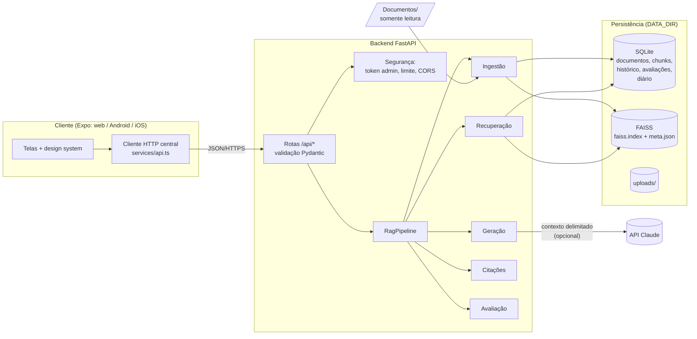
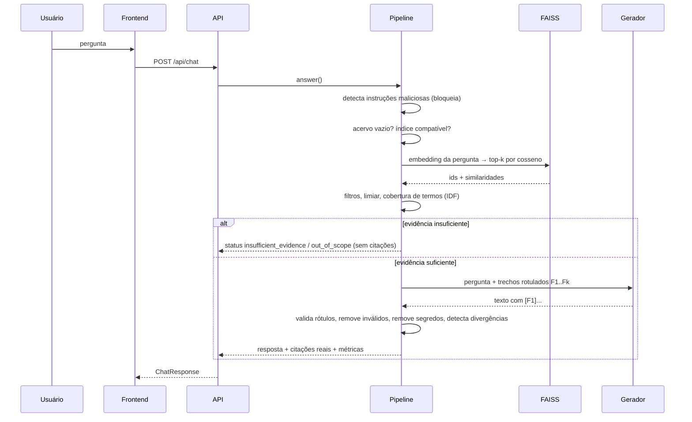

# Arquitetura do Acervo IA

## 1. Visão geral

O frontend nunca fala com o provedor de LLM nem guarda chaves: toda geração passa pelo backend.

## 2. Fluxo de dados

Ingestão: `Documentos/` → varredura recursiva → SHA-256 (novo/alterado/duplicado) → extração por página
(pypdf) → limpeza → chunking por página com sobreposição → metadados (manifesto > PDF > nome do arquivo) →
embeddings → FAISS + SQLite → relatório da execução.

## 3. Componentes (backend/app)

| Módulo | Responsabilidade |
|---|---|
| `core/config.py` | Configuração por variáveis de ambiente, validada na inicialização |
| `core/security.py` | Token administrativo, limite de requisições, saneamento de nomes, proteção contra path traversal |
| `core/errors.py` | Erros com mensagens públicas uniformes (`{"error": {code, message}}`), sem stack trace |
| `core/container.py` | Injeção de dependências; pipeline isolado para as fixtures da avaliação |
| `services/document_loader.py` | PDF (por página, OCR opcional) e TXT/MD (`\f` = quebra de página) |
| `services/text_cleaner.py` | Normalização conservadora (hifenização, espaços, números de página) |
| `services/chunking.py` | Chunks por página, sobreposição, seção detectada, IDs estáveis `doc_xxx-c0001` |
| `services/embeddings.py` | Interface + `FastEmbedProvider` (semântico) + `HashingEmbeddingProvider` (lexical, testes) |
| `services/vector_store.py` | Interface + `FaissVectorStore` + `NumpyVectorStore`; impressão digital do modelo |
| `services/ingestion.py` | Varredura idempotente, duplicatas, remoções, falhas isoladas, execução em segundo plano |
| `services/retrieval.py` | Busca, filtros, limiar, candidatos observáveis |
| `services/evidence.py` | Cobertura ponderada por IDF, divisão em frases, divergências numéricas |
| `services/generation.py` | Prompt de sistema, `AnthropicGenerator`, `ExtractiveDemoGenerator` |
| `services/citations.py` | Construção e validação das citações |
| `services/safety.py` | Detecção de injeção, escape do contexto, remoção de segredos |
| `services/evaluation.py` | Matriz de testes, métricas e relatórios JSON/Markdown |
| `services/pipeline.py` | Orquestração e consistência índice ↔ banco |
| `repositories/*` | Acesso ao SQLite (migrações versionadas por `PRAGMA user_version`) |

Frontend (`apps/mobile/src`): `app/` (rotas Expo Router), `components/` (design system em `ui/` e componentes de
domínio), `services/` (HTTP, configuração, armazenamento), `state/` (conexão, token, conversa), `theme/` (tokens),
`types/api.ts` (contrato), `__tests__/`.

## 4. Contrato frontend ↔ backend

Endpoints e tipos completos em [CONTRATO_FRONTEND.md](CONTRATO_FRONTEND.md) e em `/openapi.json`.
Principais: `GET /api/health`, `GET /api/stats`, `GET|POST|DELETE /api/documents…`, `POST /api/ingestion/scan|reindex`,
`GET /api/ingestion/status`, `POST /api/chat`, `GET /api/sources/{id}`, `GET|POST /api/evaluations…`,
`GET|PATCH /api/settings`, `GET|POST /api/mentor-log`.

## 5. Persistência

| Dado | Onde | Observação |
|---|---|---|
| Documentos originais | `Documentos/` | Somente leitura para o sistema |
| Uploads | `DATA_DIR/uploads` | Apagados ao remover o documento |
| Metadados, chunks, histórico, avaliações, diário | `DATA_DIR/database/acervo.sqlite3` | WAL, migrações versionadas |
| Vetores | `DATA_DIR/indexes/faiss.index` + `faiss.meta.json` | Formato nativo do FAISS (sem pickle) |
| Relatórios de avaliação | `DATA_DIR/evaluations/` e `docs/resultados/` | JSON + Markdown |

**Consistência:** o SQLite é a fonte da verdade. Na inicialização, o conjunto de IDs do índice é comparado ao dos
chunks processados; divergências (ex.: queda durante a indexação) disparam a reconstrução dos vetores a partir do
texto salvo. Um índice gerado com outro modelo de embeddings **não é reutilizado**: o chat responde
`index_unavailable` até a reindexação.

## 6. Decisões técnicas e alternativas

| Decisão | Escolha | Alternativas consideradas | Justificativa |
|---|---|---|---|
| Banco vetorial | FAISS `IndexIDMap2(IndexFlatIP)` | Chroma, pgvector | Instalação por pip, busca exata (acervo pequeno), remoção por ID, persistência simples e segura; Chroma traria servidor/dependências extras. A interface `VectorStore` permite trocar. |
| Métrica | Cosseno (IP sobre vetores L2-normalizados) | L2 | Padrão para sentence embeddings; valor interpretável de −1 a 1 |
| Embeddings | `paraphrase-multilingual-MiniLM-L12-v2` via fastembed (ONNX) | sentence-transformers (PyTorch), `multilingual-e5`, APIs remotas | Multilíngue (PT-BR), local, sem chave, ~120 MB, sem PyTorch (imagem menor). E5 é suportado pelo mesmo provedor (prefixos tratados). |
| Embeddings de teste | Hashing lexical | Mocks | Determinístico e offline; permite testar o pipeline real sem rede. Identificado como **não semântico** na UI. |
| Chunking | 800 caracteres, sobreposição 120, por página, quebra em títulos | Tokens, janelas fixas | Caractere é independente de tokenizador e fácil de explicar; por página garante citação de página correta; títulos evitam misturar seções (ver falha A6 em MATRIZ_TESTES) |
| LLM | Claude (`claude-opus-5-5`) via SDK oficial, esforço `low`, fallback do provedor | Modelos locais | Qualidade em português; a interface `Generator` permite um modelo local futuro |
| Banco relacional | SQLite | PostgreSQL | Sem servidor; suficiente para uma instância com disco persistente |
| Frontend | Expo + Expo Router + RN Web, design system próprio | React Native Paper, Tamagui | Uma base para web/Android/iOS; componentes próprios mantêm tokens e acessibilidade sob controle e são fáceis de explicar |
| Hospedagem | Web estática na Vercel; backend em contêiner com disco | Backend em Funções Vercel | Funções serverless têm sistema de arquivos efêmero e limites de tamanho/tempo incompatíveis com FAISS em disco, modelo ONNX e indexação longa (ver PRODUCAO.md) |

## 7. Segurança

Resumo em [SEGURANCA.md](SEGURANCA.md): separação instrução × dado, validação de citações, recusa segura, uploads
validados pelo conteúdo, path traversal, token administrativo, CORS, limites e logs sem conteúdo das perguntas.
