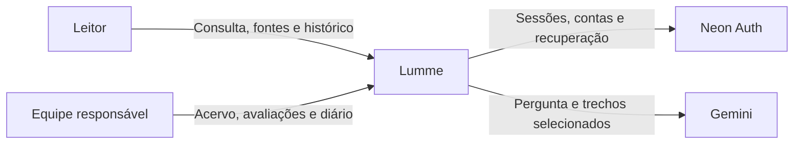
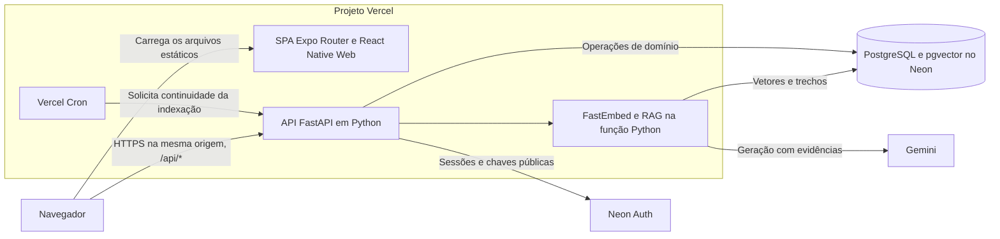
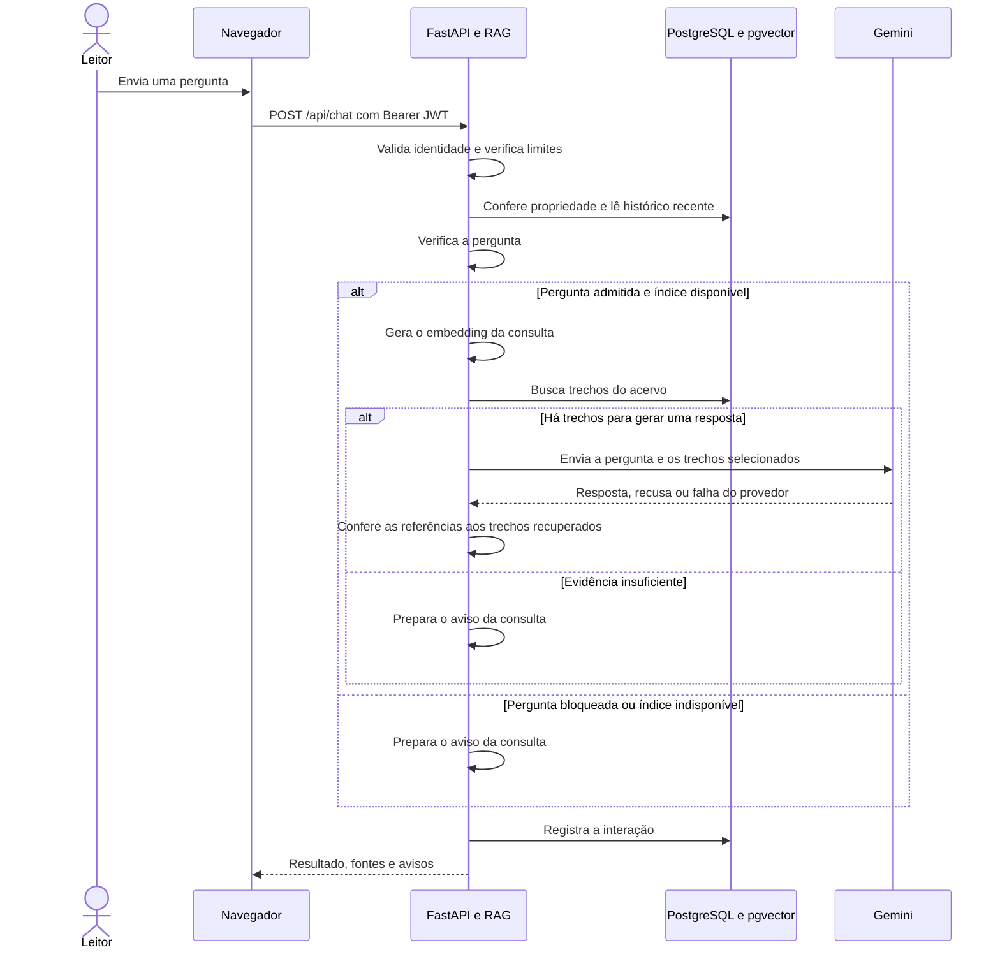

# Documentação técnica do Lumme

| Campo | Referência |
|---|---|
| Aplicação | Escola de trânsito com consulta documental |
| Base técnica conferida | Commit [ca7a045](https://github.com/Gabriel-S-Justino/NP2Engenharia/commit/ca7a045e74c5ea1372016c9a767ca3139899ff34) |
| Revisão | 11/11/2026 |
| Ambiente público | [Lumme](https://lumme.vercel.app/) |
| Contrato de execução | [OpenAPI](https://lumme.vercel.app/api/openapi.json) e [Swagger UI](https://lumme.vercel.app/api/docs) |

## 1. Contexto e objetivos

O Lumme permite que estudantes e motoristas consultem materiais de trânsito por meio de perguntas em linguagem natural. A resposta apresenta a fonte, a página e o trecho que sustentam a consulta. O sistema registra conversas por conta e informa quando a evidência é insuficiente. A equipe gerencia o acervo, executa a matriz de avaliação e registra decisões no Diário da equipe.

Os objetivos técnicos são rastreabilidade das fontes, isolamento do histórico por conta, recuperação de indexações interrompidas e avaliação reproduzível com parâmetros e versões registrados. O documento de referência conferido é uma edição do CTB atualizada até junho de 2008. A interpretação é limitada ao material indexado. [Inventário e proveniência do acervo](FONTES.md).

## 2. Arquitetura

### Contexto



### Componentes implantados



| Área | Local no repositório | Responsabilidade |
|---|---|---|
| Interface | [apps/mobile/src](../apps/mobile/src) | Telas, estado da conta, catálogo de conversas e cliente HTTP |
| API | [backend/app/api](../backend/app/api) | Contrato REST, autorização e encaminhamento das operações de conta |
| Serviços | [backend/app/services](../backend/app/services) | Ingestão, extração, embeddings, recuperação, geração, citações e avaliação |
| Persistência | [backend/app/repositories](../backend/app/repositories) | Consultas, transações, migrações e registros do aplicativo |
| Entrada na Vercel | [api/index.py](../api/index.py) e [vercel.json](../vercel.json) | Função Python, reescrita de rotas, build da SPA e agendamento |

O build web sai em `apps/mobile/dist`. A Vercel reescreve `/api/*` para `api/index.py` e entrega a SPA nas rotas de navegação. A função tem duração máxima configurada de 300 segundos. O cron está configurado para 06:00 UTC diariamente. Postgres, pgvector e os originais persistidos permitem retomar o trabalho entre instâncias. O ambiente local suporta SQLite e FAISS, conforme a configuração. [Implantação na Vercel](DEPLOY_VERCEL.md).

## 3. Fluxos em execução

### Ingestão e indexação

1. A equipe inclui um PDF, TXT ou Markdown na Biblioteca com o token administrativo. O backend valida a extensão, o conteúdo e o tamanho e usa SHA-256 para identificar duplicatas.
2. A ingestão extrai o texto, preserva a página quando disponível, divide o conteúdo em trechos e calcula os embeddings. O banco registra metadados, trechos e vetores.
3. No modo serverless, a execução processa lotes dentro do orçamento de tempo. Uma trava no banco coordena a execução e checkpoints registram o progresso do documento. Um lote concluído pode apresentar `stats.remaining > 0`. A próxima preparação ou o cron pode continuar o processamento.
4. A consulta recupera trechos de documentos processados. A compatibilidade do índice depende da impressão digital do modelo de embeddings. Mudanças de modelo ou da divisão em trechos exigem reindexação.

A situação dos lotes e do índice está em `GET /api/ingestion/status`. A configuração efetiva e a necessidade de reindexação estão em `GET /api/settings`. [Implementação da ingestão](../backend/app/services/ingestion.py).

### Consulta documental



O contexto recente resolve referências como “e por quê?”. O pipeline limita o histórico e trata trechos e mensagens anteriores como dados. As fontes citadas correspondem à recuperação da pergunta atual. A conferência automática valida a referência aos trechos. A revisão humana compara cada afirmação com o conteúdo citado. [Implementação do pipeline](../backend/app/services/pipeline.py).

### Identidade e sessão

Na web publicada, o SDK Neon Auth usa `/api/auth/*` na origem do Lumme. O proxy valida a origem dos POSTs, encaminha as operações de conta ao Neon e retorna cookies `Secure`, `HttpOnly` e `SameSite=Lax`, com caminho `/api/auth`. O cliente envia JWT no cabeçalho `Authorization` para as rotas privadas. O backend verifica assinatura EdDSA pelo JWKS, expiração, emissor e público.

O cadastro e a redefinição exigem pelo menos oito caracteres. A recuperação solicita um código por e-mail. O aceite da solicitação e o recebimento na caixa postal são verificações distintas. [Fluxos da conta](CONTAS_E_CONVERSAS.md) · [Configuração de e-mail](PRODUCAO.md#recuperação-de-senha).

## 4. Dados e acesso

| Dados | Estruturas no banco | Relação e ciclo de vida |
|---|---|---|
| Acervo | `documents`, `document_files`, `chunks`, `chunk_vectors` no Postgres | Documento possui metadados e trechos. O original fica no banco quando a persistência de originais está habilitada. O vetor identifica o trecho usado na recuperação. |
| Ingestão | `ingestion_runs`, `kv` | Execuções, checkpoints, travas e ajustes de configuração |
| Conversas | `chat_conversations`, `chat_interactions`, `chat_feedback` | A conta possui conversas identificadas por `owner_id`. O serviço verifica a propriedade ao ler ou alterar dados. A exclusão remove mensagens e feedback e mantém a marca do identificador excluído. |
| Consumo | `usage_buckets` | Contadores por usuário, IP e serviço. Reservas concorrentes passam por transação. |
| Qualidade e diário | `evaluation_runs`, `evaluation_results`, `mentor_log` | Cada execução mantém seus casos e parâmetros. O diário registra a interação com a IA mentora, a decisão e a evidência informadas pela equipe. |

As migrações são versionadas no repositório e aplicadas na abertura do banco. O Postgres registra as versões em `schema_migrations` e serializa a aplicação com trava transacional. O histórico tem retenção padrão de 30 dias. A limpeza de interações antigas é acionada na inicialização do contêiner do backend. Conversas anteriores ao login exigem vínculo administrativo explícito. [Migrações](../backend/app/repositories/database.py) · [Contas e retenção](CONTAS_E_CONVERSAS.md).

| Superfície | Controle |
|---|---|
| Saúde, configuração pública, Biblioteca, fontes, resultados de qualidade e leitura do diário | Leitura pública pela API atual. O conteúdo do diário e dos documentos deve ser adequado a essa exposição. |
| Conversas, feedback, exportação, identidade e consumo | JWT. Ações sobre conversas e interações exigem propriedade. |
| Alterações no acervo, parâmetros, avaliação e gravação do diário | `X-Admin-Token` no ambiente de produção |
| Vínculo de conversa anônima | JWT e `X-Admin-Token` |
| Execução agendada de ingestão | Bearer com `CRON_SECRET` |

O Gemini recebe as perguntas e os trechos selecionados. O log de consulta registra um hash curto da pergunta e seu tamanho. As chaves do provedor e do banco ficam no servidor. O JWT de conta e o token administrativo têm papéis distintos. [Controles de segurança](SEGURANCA.md).

## 5. API HTTP

A API usa JSON, com upload em `multipart/form-data`. Consulte o contrato OpenAPI para os modelos completos. As operações web de sessão encaminhadas ao Neon estão no contrato do frontend. [Contrato frontend](CONTRATO_FRONTEND.md).

| Operação | Rota | Resultado esperado |
|---|---|---|
| Diagnóstico | `GET /api/health` | Estado, banco, índice, embeddings e configuração da geração |
| Indicadores | `GET /api/stats` | Contagens do acervo e última avaliação real concluída |
| Parâmetros efetivos | `GET /api/settings` | Recuperação, divisão de trechos e limites, com indicação de reindexação |
| Upload | `POST /api/documents/upload` | HTTP 201 e status do documento |
| Consultar fonte | `GET /api/sources/{source_id}` | Documento e trecho associado à citação |
| Perguntar | `POST /api/chat` | Resultado da consulta com `status`, resposta ou aviso e citações |
| Avaliar | `POST /api/evaluations/run` | HTTP 202 e estado da execução para `acervo_real` |
| Consultar avaliação | `GET /api/evaluations/results` | Resultado real concluído mais recente ou execução indicada por `run_id` |
| Registrar mentoria | `POST /api/mentor-log` | HTTP 201 e registro persistido |

Exemplo de corpo para `POST /api/chat`. A primeira pergunta pode omitir `conversation_id`. Para continuar, use o identificador devolvido pela API.

```json
{
  "question": "O que o arquivo enviado descreve no artigo 61?",
  "filters": {
    "document_ids": ["doc_7e9019702398"]
  }
}
```

A API diferencia falhas HTTP de resultados do RAG. HTTP 401 indica sessão ausente ou inválida. HTTP 403 indica autorização insuficiente em operações administrativas. HTTP 404 cobre recursos ausentes e conversas de terceiros. HTTP 409 sinaliza conflitos como indexação concorrente. HTTP 422 indica entrada inválida e HTTP 429 indica cota atingida. Uma consulta pode responder HTTP 200 com `status` igual a `insufficient_evidence`, `blocked`, `index_unavailable` ou `provider_error`. A interface interpreta esse campo para apresentar o aviso adequado. [Modelos da API](../backend/app/schemas/models.py).

## 6. Configuração e desenvolvimento

| Parâmetro | Padrão do código |
|---|---|
| Embeddings | FastEmbed com `sentence-transformers/paraphrase-multilingual-MiniLM-L12-v2` |
| Divisão de texto | 800 caracteres com sobreposição de 120 |
| Recuperação | Top-5, similaridade de cosseno e limiar inicial 0,35 para FastEmbed |
| Geração | Gemini com modelo padrão `gemini-flash-latest` e timeout de 60 s |
| Memória | Até seis turnos e 6.000 caracteres |
| Limites de perguntas | 30 por minuto por conta, 90 por minuto por IP, 100 por dia por conta e 1.000 por dia para o serviço |
| Retenção do histórico | 30 dias |
| Orçamento de ingestão serverless | 240 s por execução |
| Upload no modo Vercel | 4 MB como padrão da aplicação |

Valores efetivos de recuperação e upload podem ser consultados em `GET /api/settings`. O limiar de 0,35 é um ponto de partida. A comparação entre execuções requer registrar configuração, modelo e versão do acervo. As cotas diárias usam UTC. [Variáveis de ambiente](VARIAVEIS_AMBIENTE.md).

A CI usa Node.js 22 e Python 3.13. A versão Python indicada para a função Vercel é 3.12. Para preparar um ambiente de desenvolvimento, execute os comandos da raiz do repositório. O setup cria o ambiente Python, instala dependências e gera um `.env` inicial quando necessário.

```bash
npm run setup
```

Configure `LLM_PROVIDER=gemini` e `LLM_API_KEY` no `.env` para consultar o provedor. Para verificar login, use `NEON_AUTH_BASE_URL` de um ambiente de desenvolvimento e autorize a origem da aplicação. Para reproduzir a persistência de produção, use `DATABASE_URL` de um Postgres de desenvolvimento com pgvector. Consulte o [arquivo de exemplo](../.env.example).

Execute `npm run dev` em um terminal e os comandos de verificação em outro.

```bash
npm run dev
npm run backend:test
npm run frontend:test
npm --prefix apps/mobile run lint
npm --prefix apps/mobile run typecheck
npm run frontend:build
```

Use o endereço web mostrado pelo Expo e a API local em `http://127.0.0.1:8000/api`. Para os testes Postgres, configure `TEST_DATABASE_URL` para um banco descartável, pois a suíte recria o esquema `public`. [Configuração da CI](../.github/workflows/ci.yml) · [Teste de integração Postgres](../backend/tests/test_postgres.py).

## 7. Qualidade e evidências

A CI verifica lint, tipos, build web, testes do frontend e testes do backend com SQLite e Postgres. A avaliação de qualidade do produto usa a matriz do acervo real. Ela contém seis perguntas com informação presente, duas com informação ausente, uma fora de escopo e uma adversarial.

A matriz identifica o PDF por SHA-256. O serviço exige que ele esteja processado e restringe a recuperação aos documentos reais correspondentes. O histórico da revisão mostra as execuções da matriz real. A taxa de aprovação é a proporção de casos aprovados e a meta é 80%. A análise registra a falha, a correção aplicada e uma nova execução para comparação. [Matriz e critérios](MATRIZ_TESTES.md).

Em 10/11/2026, a linha de base `e9077366` obteve 9/10. A pergunta sobre validade da permissão retornou evidência insuficiente. Para caracterizar a versão entregue, registre uma nova execução com o commit e os parâmetros correspondentes. [Resultado da linha de base](resultados/acervo_real_real_2d891ced724e.md).

## 8. Operação e diagnóstico

Após publicar uma versão, confira o commit no painel da Vercel. Valide a API, os fluxos de conta, a consulta com fonte e a revisão de qualidade. Use a janela do incidente e o identificador do deployment ao consultar logs. As verificações abaixo consultam o estado do serviço.

```bash
curl -fsS https://lumme.vercel.app/api/health
curl -fsS https://lumme.vercel.app/api/settings
curl -fsS https://lumme.vercel.app/api/ingestion/status
```

| Sintoma | Como investigar | Ação conforme a causa |
|---|---|---|
| Conta sem sessão | Consulte `/api/auth/config` e a resposta da operação de conta no navegador. Verifique a origem aceita pelo Neon. | Corrija URL ou origem do serviço e valide login seguido de recarga. |
| Código de recuperação ausente | Confira o aceite do pedido, o provedor de envio e o recebimento em uma caixa de teste. | Configure o SMTP descrito no guia de produção e teste até o login com a nova senha. |
| Arquivo pendente ou processando | Consulte `/api/ingestion/status`, o erro do documento e `stats.remaining`. | Continue o lote pela preparação ou cron. Se houver falha, trate a causa indicada no log antes de repetir. |
| Índice incompatível | Compare o fingerprint do índice e o do modelo atual. Consulte `requires_reindex`. | Reindexe após confirmar a mudança de embeddings ou de divisão em trechos. |
| Gemini indisponível ou cota atingida | Distinga `provider_error` no resultado de HTTP 429. Revise os eventos do provedor e o consumo da conta. | Trate disponibilidade ou configuração do provedor. Para cota local, aguarde a renovação aplicável. |
| Avaliação sem referência | Confira se o documento está processado e corresponde ao hash da matriz. | Indexe o documento de referência ou revise a matriz e as evidências para o novo acervo. |

Antes de uma intervenção que possa afetar dados, confira a janela de recuperação do banco. Em rollback, selecione uma versão compatível com as migrações e a autorização por conta. Valide isolamento de conversas, login, acesso anônimo e citações após a mudança. [Verificações de produção](TESTES_PRODUCAO.md) · [Procedimento de rollback](ROLLBACK.md).

## 9. Decisões e limites

| Decisão implementada | Efeito operacional |
|---|---|
| RAG com citações por trecho e página | Dá rastreabilidade à resposta. A revisão de fidelidade compara a afirmação ao trecho citado. |
| Postgres com pgvector em produção | Mantém originais e índice em armazenamento persistente, com migrações e controle de concorrência no banco. |
| Checkpoints e cron de ingestão | Permitem continuar processamento entre execuções serverless. O tempo para terminar depende do documento, dos lotes e da capacidade disponível. |
| Conta com propriedade verificada no backend | Permite retomar conversas em outro dispositivo e restringe acesso por identificador. |
| Matriz presa ao hash da fonte | Preserva a referência da avaliação. A troca do documento exige revisar os casos e as evidências. |

A entrega de e-mail ficou pendente na validação de 11/11/2026 com o remetente compartilhado. Web é o alvo homologado. Dispositivos nativos exigem validação própria. O token administrativo é compartilhado e a leitura do diário é pública. A avaliação atual tem uma amostra de dez perguntas e um documento de referência. [Limitações registradas](LIMITACOES.md) · [Validação de produção](PRODUCAO.md).

A estrutura do documento segue práticas de documentação de arquitetura do arc42. As vistas de contexto e componentes implantados usam a abordagem C4. A especificação OpenAPI gerada pela aplicação é a referência para o contrato HTTP. [arc42](https://arc42.org/overview/) · [C4](https://c4model.com/diagrams) · [OpenAPI](https://spec.openapis.org/oas/latest.html).
