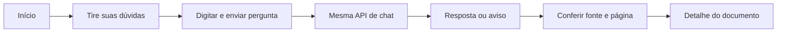
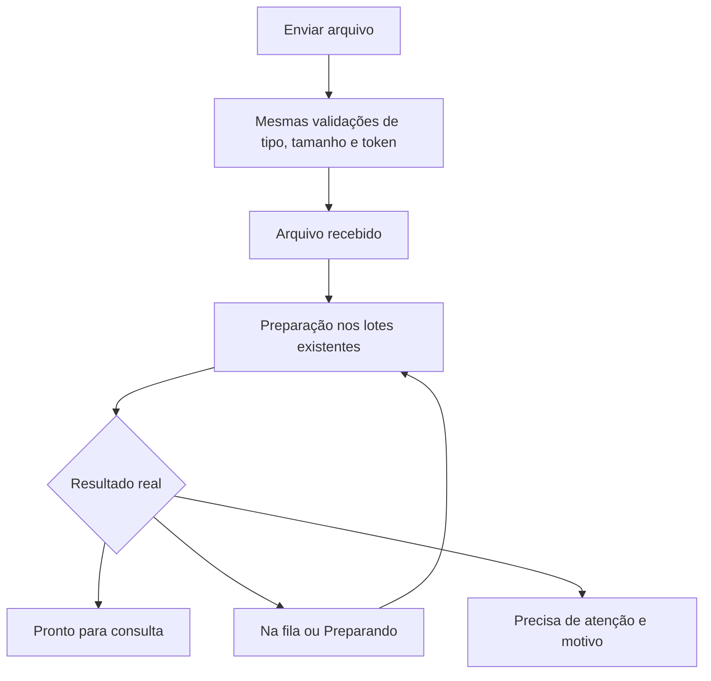

# Fluxos de UX — apresentação Escola de trânsito

Revisão de 09/11/2026. São os fluxos existentes, com novos nomes e aparência. Não há novas etapas, validações ou condições de acesso.

## Consulta

O botão Iniciar conversa mantém a condição de documento processado. Enter envia e Shift+Enter quebra a linha na web. A prevenção de envio duplicado, o histórico, a repetição e a confirmação de limpeza permanecem.

## Biblioteca e preparação

Preparar documentos chama a mesma operação de scan; Preparar novamente chama a mesma reindexação e mantém a confirmação. A continuação de lotes, o polling e a recuperação de interrupções não foram modificados nesta revisão visual.

Busca, filtros, ordenação, paginação, envio e remoção mantêm os handlers existentes. Documentos de pasta conservam o arquivo original ao serem excluídos da busca, conforme a regra anterior.

## Conferência das fontes

Na conversa, o rótulo F1 leva à fonte. No desktop, o painel De onde vem a resposta permanece ao lado; no celular, Conferir fontes abre o mesmo painel inferior. Ver trecho, Detalhes da fonte, Abrir original e paginação continuam disponíveis.

Scores e candidatos descartados deixam de ser apresentados. Documento, página, autoria, licença, trecho e avisos relevantes permanecem.

## Estados e falhas

Avisos de informação insuficiente, divergência, conteúdo suspeito, citação inválida e indisponibilidade continuam presentes. A mensagem visual pode traduzir termos técnicos; os status e os dados da API não mudam. Somente falhas já classificadas como repetíveis mostram a ação existente Tentar novamente.

## Ferramentas da equipe

Revisão de qualidade mantém seleção de conjunto, execução, histórico, filtros e registro de ajustes. Diário da equipe mantém formulário, validação e salvamento. Configurações mantém verificação de disponibilidade, quatro parâmetros editáveis, confirmação de reprocessamento, token, privacidade e tema.

O agrupamento Espaço da equipe é somente uma indicação visual: nenhuma rota foi removida ou recebeu nova autenticação.
