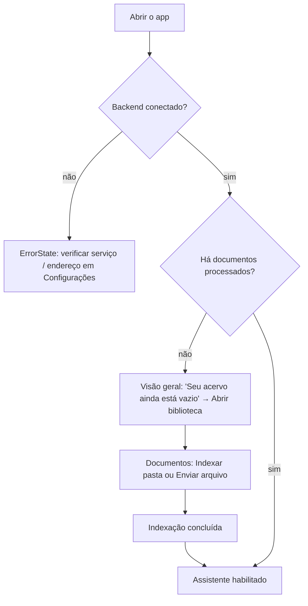
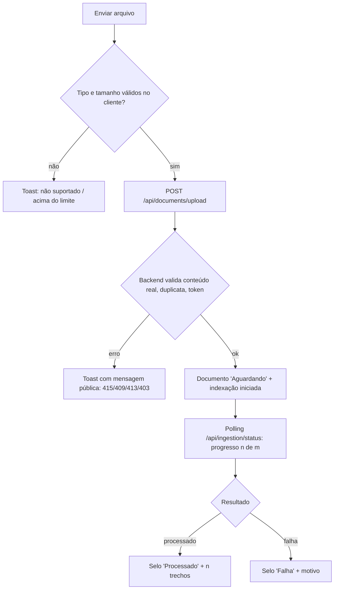
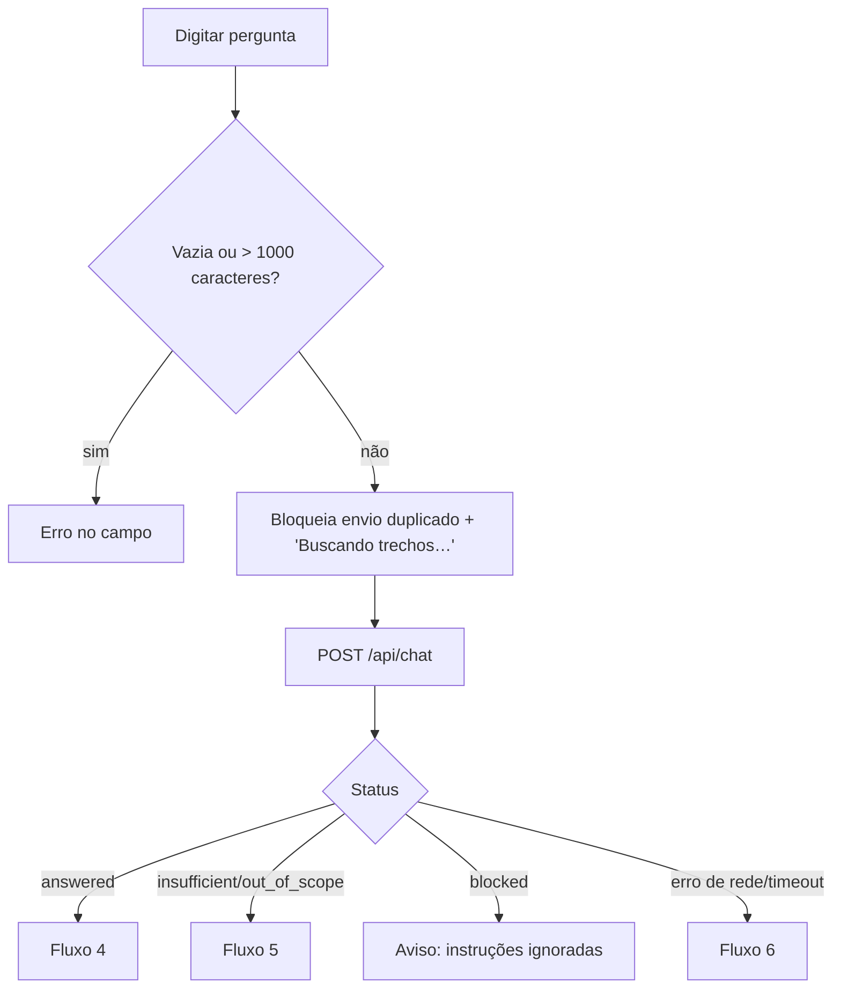
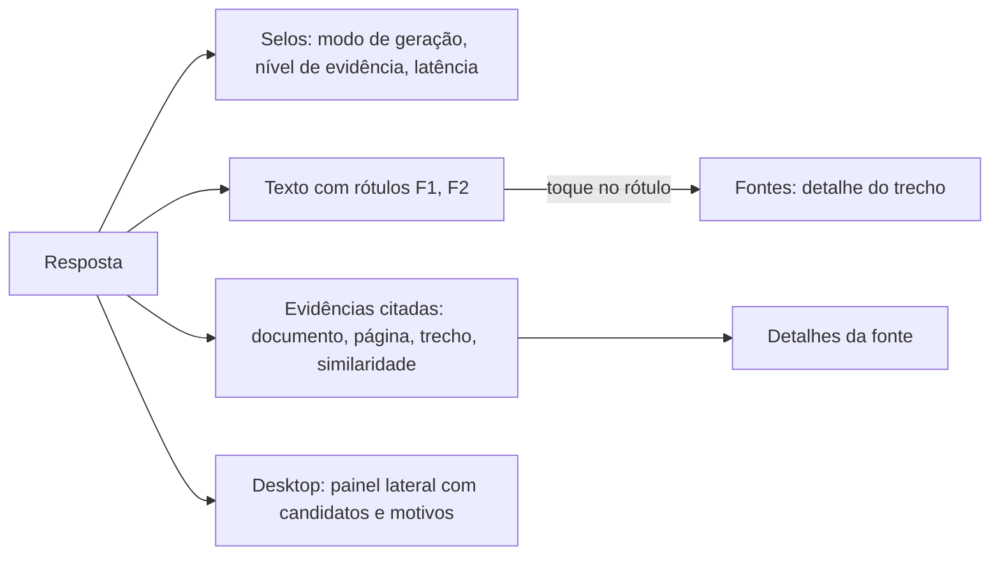
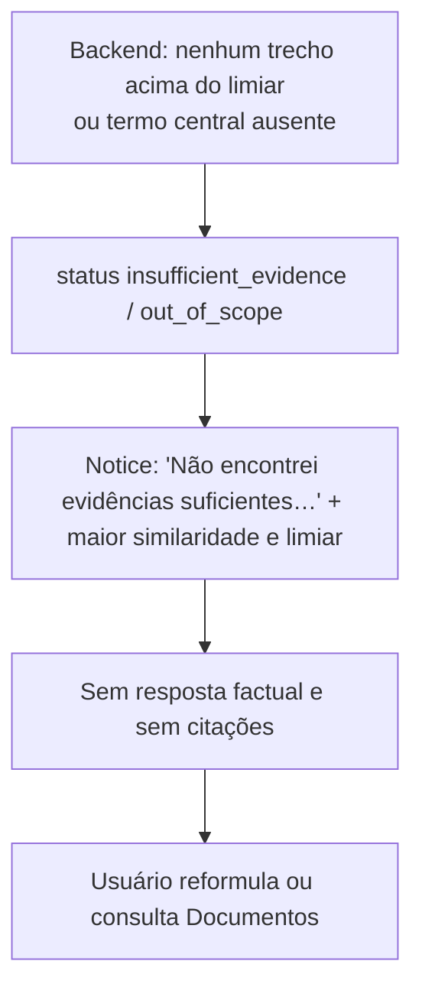
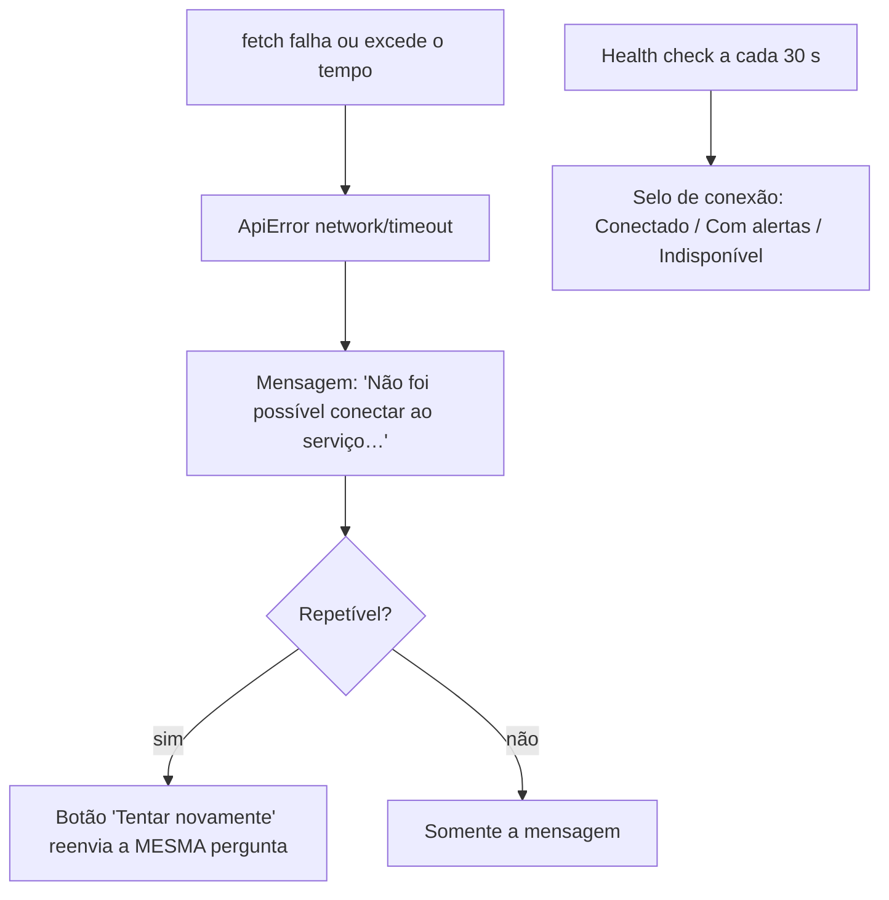
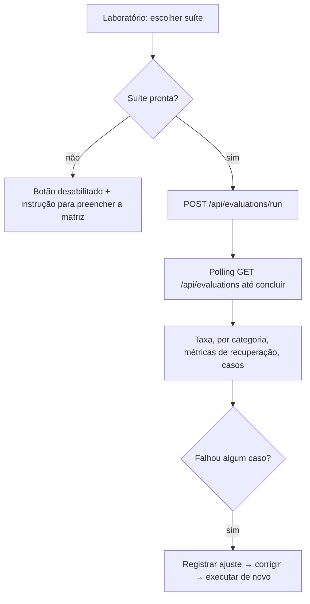
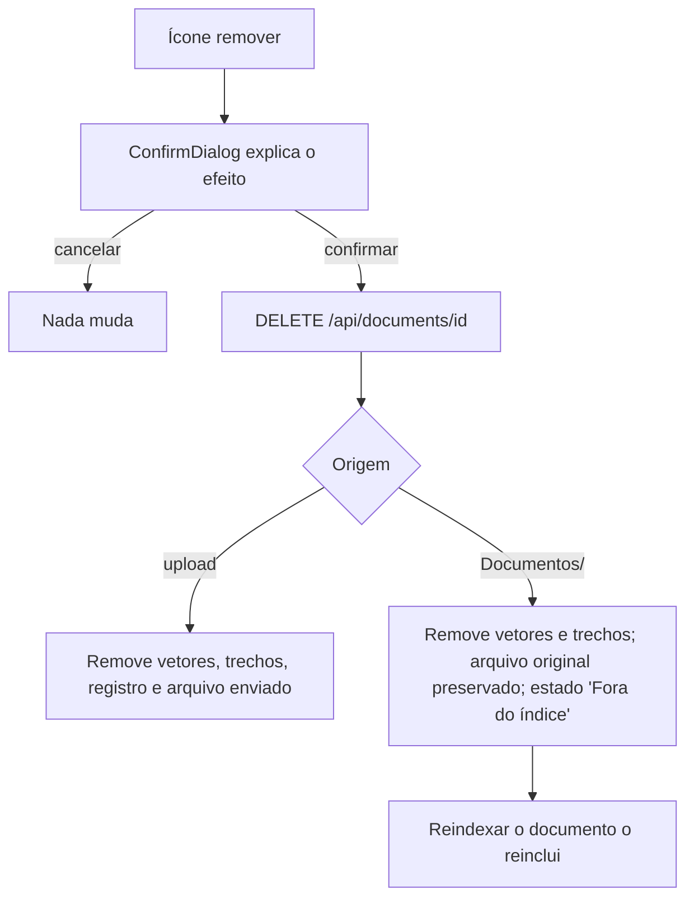

# Fluxos de UX

## 1. Primeira utilização

## 2. Adição e indexação de documentos

Indexar a pasta segue o mesmo caminho a partir de `POST /api/ingestion/scan`.

## 3. Envio de uma pergunta

## 4. Resposta com fontes

## 5. Pergunta sem evidências suficientes

## 6. Falha de conexão

## 7. Execução dos testes

## 8. Remoção de documentos

