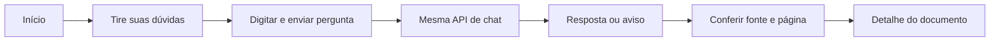
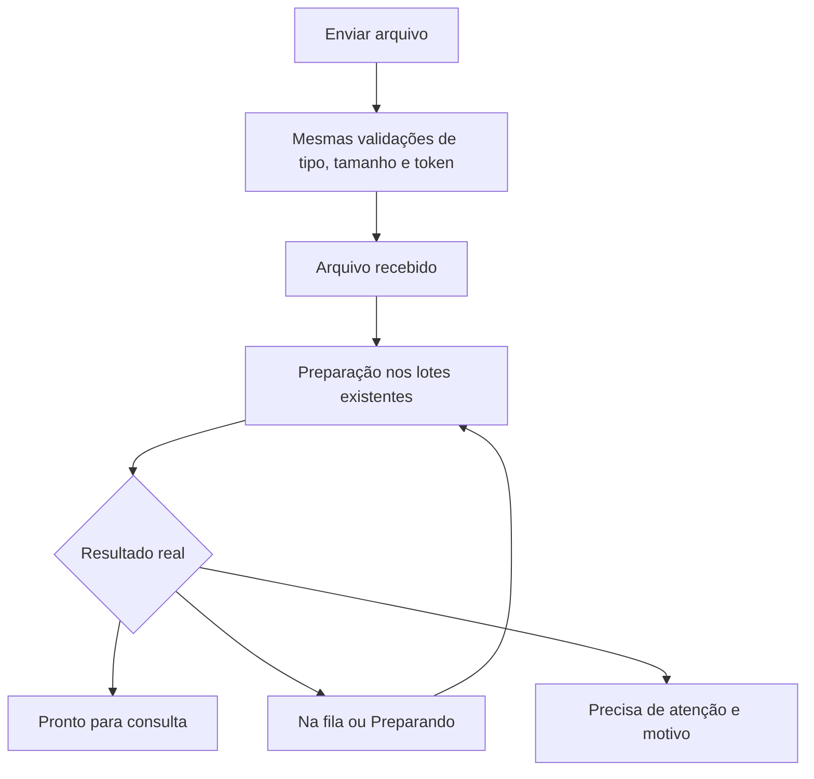

# Fluxos de UX - apresentação Escola de trânsito

Atualizado em 10/11/2026. Contas, memória contextual, propriedade do histórico, ações da sidebar e cotas estão descritas em [Contas e conversas](CONTAS_E_CONVERSAS.md). A avaliação real e a edição antiga do acervo estão em [Matriz](MATRIZ_TESTES.md) e [Fontes](FONTES.md).

Revisão de 09/11/2026. São os fluxos existentes, com novos nomes e aparência. Não há novas etapas, validações ou condições de acesso.

## Consulta

O botão Iniciar conversa mantém a condição de documento processado. Enter envia e Shift+Enter quebra a linha na web. A prevenção de envio duplicado, o histórico, a repetição e a confirmação de limpeza permanecem.

## Biblioteca e preparação

Preparar documentos chama a mesma operação de scan; Preparar novamente chama a mesma reindexação e mantém a confirmação. A continuação de lotes, o polling e a recuperação de interrupções não foram modificados nesta revisão visual.

Busca, filtros, ordenação, paginação, envio e remoção mantêm os handlers existentes. Documentos de pasta conservam o arquivo original ao serem excluídos da busca, conforme a regra anterior.

## Conferência das fontes

Na conversa, o rótulo F1 leva à fonte. No desktop, o painel De onde vem a resposta permanece ao lado; no celular, Conferir fontes abre o mesmo painel inferior. Ver trecho, Detalhes da fonte, Abrir original e paginação continuam disponíveis.

Scores e candidatos descartados deixam de ser apresentados. Documento, página, autoria, licença, trecho e avisos relevantes permanecem.

## Estados e falhas

Avisos de informação insuficiente, divergência, conteúdo suspeito, citação inválida e indisponibilidade continuam presentes. A mensagem visual pode traduzir termos técnicos; os status e os dados da API não mudam. Somente falhas já classificadas como repetíveis mostram a ação existente Tentar novamente.

## Ferramentas da equipe

Revisão de qualidade mantém seleção de conjunto, execução, histórico, filtros e registro de ajustes. Diário da equipe mantém formulário, validação e salvamento. Configurações mantém verificação de disponibilidade, quatro parâmetros editáveis, confirmação de reprocessamento, token, privacidade e tema.

O agrupamento Espaço da equipe organiza as ferramentas administrativas. O acesso às conversas agora exige uma conta, independentemente do token administrativo.

## Criar e retomar conversas

Sidebar → Nova conversa abre um chat vazio sem excluir os anteriores. Sidebar → Buscar chats → buscar pelo título → selecionar → carregar todas as páginas → continuar a conversa. Falha de carregamento mantém o chat anterior. Para remover, use Opções da conversa → Excluir → Confirmar exclusão; uma falha no servidor mantém o conteúdo e apresenta o erro. [Guia](HISTORICO_CHATS.md).

## Navegação lateral

Desktop: sidebar com Nova conversa, atalhos, busca e Seus chats. Recolher menu alterna para ícones; Buscar chats expande a lista. Celular: Abrir menu de conversas mostra o mesmo conteúdo em um painel à esquerda; selecionar conversa ou rota fecha o painel. Ferramentas da equipe expande Revisão de qualidade e Diário da equipe. Configurações permanece no rodapé. A antiga barra inferior e o modal separado de histórico foram substituídos por essa navegação.

## Conta e ações

Sua conta → Criar conta ou Entrar → abrir catálogo do servidor. Esqueci minha senha → solicitar código → atualizar senha → entrar. O menu de cada chat permite renomear, exportar e excluir com confirmação. A resposta oferece copiar e feedback. Sua conta mostra consumo e permite sair; ao sair, mensagens da conta deixam de ser exibidas.
