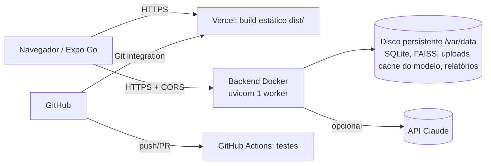

# Arquitetura de produção

## Auditoria de compatibilidade com a Vercel

| Componente | Requisito operacional | Vercel (funções serverless) | Decisão |
|---|---|---|---|
| Frontend web (Expo + RN Web) | Arquivos estáticos + rewrite de SPA | Compatível | **Vercel** (`apps/mobile/vercel.json`) |
| API FastAPI | Processo Python | Possível em funções Python | Viável, mas os itens abaixo impedem |
| Índice FAISS e SQLite | Disco gravável **persistente** entre requisições e deploys | Sistema de arquivos das funções é efêmero/somente leitura fora de `/tmp` | Incompatível sem trocar a persistência |
| Modelo de embeddings (ONNX, ~120 MB + runtime) | Download e cache persistentes, memória | Pacote de função tem limite de tamanho; cache perdido a cada instância fria | Incompatível na prática |
| Ingestão/reindexação de PDFs | Execução longa em segundo plano | Funções têm duração máxima e não mantêm threads após a resposta | Incompatível |
| Uploads de documentos | Armazenamento persistente | Exigiria armazenamento externo (blob) | Incompatível sem mudança |

**Conclusão:** frontend estático na **Vercel**; backend como **contêiner Docker com disco persistente** num serviço
compatível (blueprint para **Render** em `render.yaml`; Railway e Fly.io também servem). Essa arquitetura preserva
o pipeline local (SQLite + FAISS em disco) sem reescrita. Mover o backend para a Vercel exigiria trocar SQLite por
Postgres gerenciado, FAISS por banco vetorial gerenciado (ex.: pgvector), embeddings por API remota e ingestão por
fila — mudanças documentadas como alternativa, não necessárias para os requisitos.

## Persistência e operação

| Item | Implementação |
|---|---|
| Banco | SQLite em `/var/data/database/acervo.sqlite3` (WAL). Migrações versionadas por `PRAGMA user_version` aplicadas na inicialização. |
| Arquivos | Uploads em `/var/data/uploads`; documentos públicos versionados entram na imagem em `/app/Documentos` (somente leitura). |
| Índice vetorial | `/var/data/indexes/faiss.index` + `faiss.meta.json` (impressão digital do modelo). Reconstrução automática se inconsistente; reindexação obrigatória se o modelo mudar. |
| Modelo de embeddings | Cache em `/var/data/models` (`EMBEDDING_CACHE_DIR`), baixado uma vez. |
| Inicialização | `AUTO_INGEST_ON_STARTUP=true` indexa documentos novos/alterados da imagem a cada deploy (idempotente). |
| Retenção | Histórico de chat expurgado após `HISTORY_RETENTION_DAYS`; remoção de documento limpa vetores, trechos e upload. |
| Escala | **1 instância, 1 worker** (SQLite + índice em memória do processo). Escalar exige banco/índice compartilhados. |

### Backup e recuperação
1. Backup diário do disco (snapshot da plataforma, se disponível) ou cópia de `/var/data/database` e `/var/data/uploads`.
   Use `sqlite3 acervo.sqlite3 ".backup backup.sqlite3"` para cópia consistente com o serviço ativo.
2. O índice FAISS é **derivado**: pode ser reconstruído a partir do SQLite (automático ao iniciar) ou com
   **Reindexar tudo**. Não é crítico no backup.
3. Restauração: parar o serviço, repor `database/` e `uploads/`, iniciar; verificar `/api/ingestion/status`
   (`consistent: true`).

## Segurança em produção
- `APP_ENV=production` exige `ADMIN_TOKEN` para upload, indexação, exclusão, avaliação e configurações; sem token,
  essas operações ficam bloqueadas.
- `CORS_ORIGINS` = domínio(s) exatos da Vercel; `*` é rejeitado na inicialização.
- Segredos (`LLM_API_KEY`, `ADMIN_TOKEN`) apenas no painel da hospedagem do backend. A Vercel recebe somente
  `EXPO_PUBLIC_API_URL` (pública).
- Contêiner sem root; somente `/var/data` gravável; HTTPS terminado pela plataforma; `--proxy-headers`.
- Limite de perguntas por minuto (`RATE_LIMIT_PER_MINUTE`) para controlar abuso e custo do LLM.
- Logs JSON sem texto das perguntas (hash + tamanho) e sem segredos.

## Observabilidade
- Saúde: `GET /api/health` (usado pelo health check da plataforma e do Docker).
- Ingestão: `GET /api/ingestion/status` (consistência índice ↔ banco, compatibilidade do modelo).
- Métricas de uso: `GET /api/stats` (latências médias, taxa de citações válidas, recusas, sucesso da ingestão).
- Logs estruturados no stdout (visíveis no painel da plataforma).

## Estados da entrega
- **Implementado:** código, configuração de deploy (`Dockerfile`, `render.yaml`, `vercel.json`, CI).
- **Validado localmente:** build web de produção, testes, E2E contra backend real, modo produção do backend.
- **Preparado para deploy:** sim (ver [TESTES_PRODUCAO.md](TESTES_PRODUCAO.md)).
- **Preview publicado e validado:** **não** — requer contas Vercel/Render da equipe.
- **Produção publicada:** **não** — requer autorização explícita do responsável.
