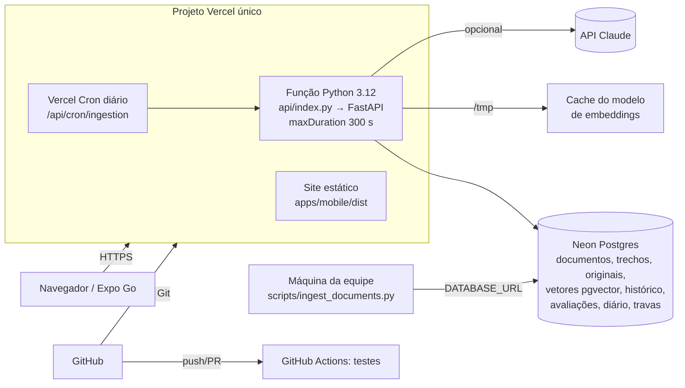

# Arquitetura de produção (Vercel + Neon Postgres)

## Visão geral

## Auditoria de compatibilidade e decisões

| Requisito do backend | Restrição da Vercel | Solução adotada |
|---|---|---|
| Persistir documentos, metadados e histórico | Sistema de arquivos efêmero (apenas `/tmp`) | Postgres (Neon) via `DATABASE_URL`; SQLite continua para uso local |
| Índice vetorial persistente | Idem | **pgvector** na mesma base (`chunk_vectors`, distância de cosseno `<=>`), com chave estrangeira para `chunks` (remover trecho remove o vetor) |
| Reindexar sem acesso aos arquivos | O pacote da função não contém os PDFs da equipe | Originais guardados no banco (`document_files`) |
| Ingestão longa | Duração máxima por chamada; sem trabalho em segundo plano após a resposta | Ingestão **síncrona em lotes** com orçamento (`INGESTION_TIME_BUDGET_SECONDS`, padrão 240 s), fila de pendentes no banco, ao menos 1 documento por chamada, continuação automática pela interface e cron diário |
| Execuções concorrentes | Várias instâncias simultâneas | **Trava no banco** (lease com expiração) para ingestão; migrações com `pg_advisory_xact_lock` |
| Modelo de embeddings (~120 MB) | Pacote limitado; cold starts | Modelo baixado sob demanda para `/tmp` (não entra no pacote); carga preguiçosa (health e listagens não carregam o modelo) |
| Tamanho do pacote | Limite de pacote descompactado da função (500 MB na documentação atual; 250 MB em páginas antigas) | Dependências enxutas (sem FAISS/uvicorn); pacote medido pelo `vercel build`: **~221 MB** |
| Upload | Corpo de requisição limitado a 4,5 MB | `MAX_UPLOAD_SIZE_MB=4` na Vercel; arquivos maiores pela CLI direto no banco |
| Ciclo de vida da aplicação | Lifespan não é garantido em todos os modos | Contêiner criado sob demanda na primeira requisição |
| Caminho reescrito | `/api/*` é reescrito para `/api/index?path=…` | Adaptador ASGI restaura o caminho original (`app/core/vercel.py`) |
| CORS | — | Web e API na mesma origem; apps nativos não usam CORS |

O modo local (SQLite + FAISS + execução em segundo plano) e a alternativa com contêiner Docker e disco persistente
([DEPLOY_BACKEND.md](DEPLOY_BACKEND.md)) continuam disponíveis; o código seleciona o modo pelas variáveis.

## Dados

| Tabela | Conteúdo |
|---|---|
| `documents`, `chunks` | Metadados, estado de processamento, trechos com página/seção |
| `chunk_vectors` | Vetor de cada trecho (pgvector) |
| `document_files` | Arquivo original (bytea) |
| `kv` | Metadados do índice (impressão digital do modelo), parâmetros ajustados, travas |
| `ingestion_runs`, `chat_interactions`, `evaluation_runs`, `evaluation_results`, `mentor_log` | Execuções, histórico, avaliações e diário |
| `schema_migrations` | Versão do esquema |

Migrações versionadas e idempotentes rodam na primeira conexão de cada instância (serializadas por advisory lock).
A avaliação sintética usa um banco **descartável em `/tmp`** (SQLite + vetores em arquivo) para nunca misturar
fixtures ao acervo real; os **resultados** da avaliação são gravados no Postgres.

### Backup e recuperação
- O Neon mantém histórico e permite restaurar um *branch* para um ponto no tempo (confira a janela de retenção do
  seu plano). Antes de mudanças grandes, crie um *branch* de backup no painel.
- Exportação manual: `pg_dump "$DATABASE_URL" -Fc -f acervo.dump`; restauração: `pg_restore -d "$DATABASE_URL" acervo.dump`.
- Os vetores são derivados: podem ser recalculados por **Reindexar tudo** a partir dos originais no banco.

## Segurança em produção
- `APP_ENV=production` automático na Vercel: upload, indexação, exclusão, avaliação e configurações exigem
  `ADMIN_TOKEN`; sem ele, ficam bloqueadas.
- Sem `DATABASE_URL`, a API recusa alterar o acervo (503 `armazenamento_efemero`) para não perder dados em silêncio.
- `CRON_SECRET` protege a rota agendada. Segredos ficam só nas variáveis da Vercel; o bundle web não contém chaves
  (verificado no CI).
- Logs JSON sem texto das perguntas. Limite de perguntas por minuto **por instância** (memória).

## Observabilidade
`/api/health` (banco, armazenamento, modelo, índice, LLM), `/api/ingestion/status` (execução atual, última execução,
consistência índice ↔ banco), `/api/stats` (latências e métricas de uso), logs da função no painel da Vercel.

## Alternativas (se algum limite da plataforma mudar)
- **Pacote acima do limite do plano:** usar provedor de embeddings remoto (exige implementar um novo
  `EmbeddingProvider` e chave) ou hospedar a API como contêiner (DEPLOY_BACKEND.md) mantendo a web na Vercel.
- **Indexações muito longas:** indexar pela CLI na máquina da equipe (opção B do DEPLOY_VERCEL.md).

## Estados da entrega
- **Implementado e validado localmente:** sim — `vercel build` oficial concluído; a função gerada foi executada pelo
  handler do runtime Python da Vercel contra Postgres + pgvector; simulação local web + API na mesma origem com
  E2E 11/11 (ver [TESTES_PRODUCAO.md](TESTES_PRODUCAO.md)).
- **Preparado para deploy na Vercel:** sim.
- **Preview publicado e validado:** não — requer a conta Vercel/Neon da equipe.
- **Produção publicada:** não — requer autorização explícita do responsável.
